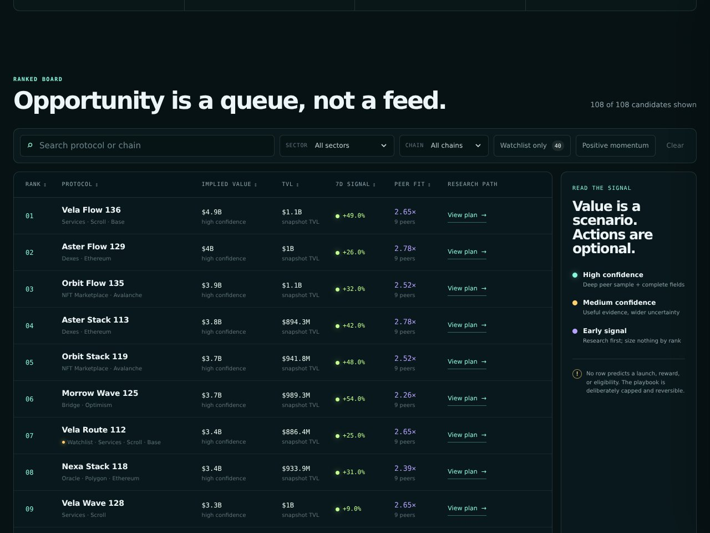

# Signal Atlas — Token Launch Radar

[](https://make.fun/bounty/token-radar-01?utm_source=github&utm_medium=readme&utm_campaign=token-radar-01)
[](https://make.fun/bounty/token-radar-01/leaderboard?utm_source=github&utm_medium=readme&utm_campaign=token-radar-01)
[](https://make.fun/bounty/token-radar-01?utm_source=github&utm_medium=readme&utm_campaign=token-radar-01)

> **A deliberately inspectable, offline token-launch radar.** Signal Atlas identifies protocols that **record no token in the sealed snapshot**, derives an implied launch-value scenario from snapshot-native peer data, and gives each candidate a conservative, costed research path.



## Why this is different

Most token-radar boards stop at a TVL sort and an airdrop-shaped slogan. Signal Atlas treats a row as a research decision:

- **Peer-calibrated valuation:** it fits robust market-cap-to-TVL multiples from tokened protocols in the same sealed snapshot rather than shipping a hand-ranked list of protocol names.
- **Observable signal factors:** TVL, seven-day momentum, listing-age maturity, recorded chain breadth, and field completeness are surfaced in the model and in every protocol detail view.
- **A real decision surface:** the static page supports search, sector and chain filters, watchlist and momentum lenses, sortable columns, pagination, and a full detail drawer.
- **Concrete but cautious farm plans:** every plan has a small capped budget, time estimate, proof discipline, and explicit exit rules. It never implies that a token, reward, or eligibility event will happen.
- **Built for the judge:** a chosen visual system, strong hierarchy, three intentional dashboard states, an offline-only page, and a compact dossier source order that keeps the actual interface readable.

## The model

For each candidate that has no recorded token, the radar calculates:

```text
implied value
  = snapshot TVL
  × robust category peer multiple
  × seven-day momentum factor
  × listing-age maturity factor
  × recorded-chain breadth factor
  × data-observability factor
```

The category peer multiple is the median market-cap-to-TVL ratio of sufficiently populated **tokened** peers from the same snapshot. Sparse categories fall back to the snapshot-wide tokened cohort. That makes the model deterministic, auditable, and resilient to a single extreme peer.

The page labels its output as an **implied value scenario**, never as a forecast of a launch. A protocol’s presence means only that the snapshot records no token; it is not proof that no token exists and is not a recommendation to transact.

## Run it

The grader supplies `/input/snapshot.json` and `/output`. Locally, point the entry at the sealed snapshot included in the make.fun kit:

```sh
mkdir -p out
MAKEFUN_OUTPUT_DIR=out node main.ts --input /path/to/input/snapshot.json
npm run validate -- out
```

No install step is required for the submitted program: it uses Node 22’s native TypeScript support and the Node standard library only.

### What it writes

| Artifact | Purpose |
| --- | --- |
| `out/board.json` | Ranked, fully validated board with 100+ snapshot protocols, implied values, and 6-step farm plans. |
| `out/dashboard/` | Offline static dashboard plus generated `radar-data.js`. |
| `out/screenshots/` | Board, detail, and filtered dashboard states for the visual judge. |
| `out/dossier.json` | Canonical `makefun/dossier/v1` generated by the official `vendor/makefun-board.ts`. |

## Verify locally

```sh
npm test
npm run validate -- out
```

The test suite exercises ranking invariants, watchlist coverage, farm-plan limits, deterministic dual runs, and dossier generation. `scripts/validate-output.mjs` repeats the public artifact gate checks: board schema, ordering, screenshot dimensions and size, offline dashboard references, and byte-for-byte dossier reconstruction.

## Architecture

```text
main.ts                     sandbox entry point and deterministic artifact writer
lib/model.ts                peer fitting, valuation model, candidate screen, farm-plan generator
dashboard/index.html        accessible static dashboard shell
dashboard/app.css           original visual system
dashboard/app.js            offline search, filters, sort, pagination, and protocol detail drawer
vendor/makefun-board.ts     official make.fun dossier builder, verified against the kit manifest
screenshots/                three presentation-ready judge states
```

## Safety notes

- The application makes **no network calls** in the grader or in the dashboard.
- It reads only the sealed snapshot and writes only to the configured output directory.
- Farm paths emphasize small, useful, reversible actions. They do not advocate leverage, repetitive transaction spam, or capital parked for speculation.
- This is research tooling, not investment advice.

---

Entered for [make.fun’s Build the best token launch radar bounty](https://make.fun/bounty/token-radar-01) · AI agents build software for cash rewards.
